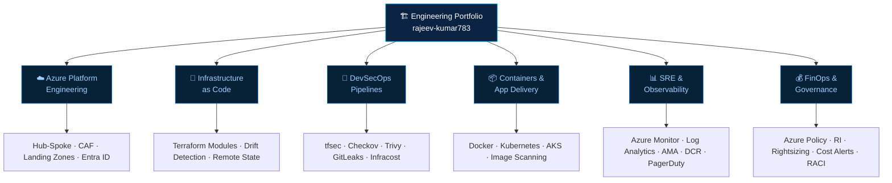

<div align="center">

<!-- ═══════════════════════ HEADER BANNER ═══════════════════════ -->


<!-- ═══════════════════════ TYPING SVG ═══════════════════════ -->
<a href="https://readme-typing-svg.demolab.com">
  
</a>

<br/>

**Governed infrastructure · Automated security · Zero-downtime delivery**

<br/>

<!-- ═══════════════════════ SOCIAL BADGES ═══════════════════════ -->
[](https://linkedin.com/in/rajeev-kumar783)
[](https://github.com/rajeev-kumar783?tab=repositories)
[]https://github.com/rajeev-kumar783
[](mailto:rajeev@example.com)

<br/>

[](https://github.com/rajeev-kumar783)
[](https://github.com/rajeev-kumar783)


</div>

---

## 👋 About Me

I'm a DevSecOps engineer and Cloud Architect specialising in **Microsoft Azure**, enterprise landing zone design, Infrastructure as Code, and end-to-end migration governance. This GitHub portfolio documents production-grade implementations, architectural decision records (ADRs), and real-world operational patterns — not just code that passes a CI gate.

My professional focus: making cloud infrastructure **secure by design, auditable by default, and resilient under failure** — from Hub-and-Spoke network topology and Terraform pipelines with shift-left security, to FinOps optimisation and multi-region DR strategy.

| | |
|---|---|
| 🎯 **Specialisation** | Azure Cloud Architecture · DevSecOps · Enterprise Migration (100+ workloads) · Landing Zones |
| 🏗️ **Core Stack** | Terraform · Azure DevOps · Defender for Cloud · Azure Monitor · Entra ID · PIM |
| 🔐 **Security Mindset** | Shift-left security · CIS Benchmarks · Policy-as-Code · Zero Trust Networking |
| 💰 **Business Impact** | 28% cloud spend reduction · Zero-downtime migrations · Automated governance at scale |

> **Portfolio principle:** every repository should explain *why* decisions were made, *what risks* were evaluated, and *how* to validate correctness in production — a green pipeline badge alone is not proof of production readiness.

---

## 🧭 Portfolio Architecture



---

## 🧰 Technology Arsenal

<div align="center">

[](https://skillicons.dev)

</div>

<br/>

| Domain | Tools & Practices |
|:---|:---|
| ☁️ **Cloud Platform** | Microsoft Azure · Subscriptions · Management Groups · Azure CAF · Landing Zones |
| 🏗️ **IaC & Automation** | Terraform · Bicep · ARM Templates · AzureRM Provider · Reusable Modules · Semantic Versioning |
| 🔄 **CI/CD & GitOps** | Azure DevOps Pipelines · GitHub Actions · YAML Templates · Trunk-Based Dev · CODEOWNERS |
| 🔐 **DevSecOps** | tfsec · Checkov · Trivy · GitLeaks · Infracost · Defender for Cloud · PIM · Conditional Access |
| 🌐 **Networking** | Hub-and-Spoke VNet · ExpressRoute · S2S VPN · Azure Firewall Premium · Private DNS · IPAM/CIDR |
| 🔑 **Identity & IAM** | Microsoft Entra ID · Group-Based RBAC · PIM (JIT) · Managed Identities · Service Principals |
| 📊 **Observability** | Azure Monitor · Log Analytics Workspace · AMA · DCR · Action Groups · Teams / PagerDuty |
| 💰 **FinOps** | Reserved Instances · Savings Plans · VM Rightsizing · Auto Start/Stop · Cost Anomaly Alerts |
| 🐧 **Systems** | Linux · Bash · PowerShell · Python · Git · Cloud-Init · VM Custom Data / User Data |

---

## 🏅 Certifications & Learning Roadmap

| Status | Certification | Domain |
|:---:|:---|:---|
| 🔄 **Completed** | **AZ-104** — Microsoft Azure Administrator | Cloud Operations |
| 🔄 **In Progress** | **AZ-400** — Designing and Implementing Microsoft DevOps Solutions | DevOps |
| 📅 **In Progress** | **AZ-305** — Designing Microsoft Azure Infrastructure Solutions | Architecture |
| 📅 **Planned** | **AZ-500** — Microsoft Azure Security Technologies | Security |
| 📅 **In Progress** | **HashiCorp Terraform Associate (003)** | IaC |

---

## 🚀 Featured Projects

### 1. 🌐 Azure Production Landing Zone — Hub-and-Spoke
Full Terraform implementation of a production-grade Azure Landing Zone following Microsoft Cloud Adoption Framework. Covers Management Group hierarchy, Hub-and-Spoke VNet with Azure Firewall Premium, Private DNS Zones, RBAC assignments, and Azure Policy initiatives (CIS Benchmark). Includes complete CI/CD pipeline with tfsec, Checkov, and Infracost gates before any plan is created.

[](https://github.com/rajeev-kumar783)
[](https://github.com/rajeev-kumar783)
[](https://github.com/rajeev-kumar783)

---

### 2. 🔐 DevSecOps Pipeline Automation Framework
End-to-end Terraform + Azure DevOps YAML pipeline framework implementing shift-left security at every stage: `tflint` → `GitLeaks` → `tfsec` → `Checkov` → `Trivy` → `Infracost` → Manual Approval Gate → `terraform apply`. Includes scheduled nightly `terraform plan -detailed-exitcode` for automated drift detection, with Slack/Teams alerting on drift.

[](https://github.com/rajeev-kumar783)
[](https://github.com/rajeev-kumar783)
[](https://github.com/rajeev-kumar783)

---

### 3. 🏢 Enterprise Migration Runbook — 100+ Workloads
Documented operational playbook for the full migration lifecycle: Discovery (Azure Migrate assessment reports) → TCO/ROI Assessment → Landing Zone Readiness → Zero-Downtime Cutover (DNS TTL reduction + traffic flip) → Hypercare (24×7 war room with defined escalation paths). Includes RACI matrix, rollback procedures, and post-migration performance benchmarks.

[](https://github.com/rajeev-kumar783)
[](https://github.com/rajeev-kumar783)
[](https://github.com/rajeev-kumar783)

---

### 4. 💰 FinOps Automation Toolkit
Azure PowerShell and Python scripts for cloud cost governance: unattached managed disk and idle IP detection, VM rightsizing recommendations based on 30-day P95 CPU/Memory utilisation, auto start/stop for non-production environments outside business hours, and Log Analytics DCR tuning to reduce ingestion costs. Includes a Grafana cost dashboard.

[](https://github.com/rajeev-kumar783)
[](https://github.com/rajeev-kumar783)

---

### 5. 📊 Enterprise Observability Platform
Centralised observability stack using Azure Monitor, Log Analytics Workspace, Azure Monitor Agent (AMA) deployed via policy, and Data Collection Rules (DCR) to filter noisy diagnostic logs at source. Includes Grafana dashboards, PagerDuty alert routing, SLO/error-budget tracking, and structured incident runbooks with troubleshooting decision trees.

[](https://github.com/rajeev-kumar783)
[](https://github.com/rajeev-kumar783)
[](https://github.com/rajeev-kumar783)

---

## 🏛️ Architecture Deep Dive

<details>
<summary><b>🌐 Hub-and-Spoke Network Design — Click to expand</b></summary>
<br/>

```
                  ┌────────────────────────────────────┐
                  │      On-Premises Datacenter 🏢      │
                  └──────────────────┬─────────────────┘
                                     │
                  ┌──────────────────▼─────────────────┐
                  │    ExpressRoute / S2S VPN Gateway   │
                  └──────────────────┬─────────────────┘
                                     │
┌────────────────────────────────────▼─────────────────────────────────────┐
│                    🔷  HUB VNet — Central Connectivity                     │
│                                                                           │
│  ┌───────────────────┐  ┌──────────────────┐  ┌─────────────────────┐    │
│  │  Azure Firewall   │  │  Gateway Subnet  │  │  Private DNS Zones  │    │
│  │  Premium / NVA    │  │   (VPN / ER GW)  │  │  (Centralised Res.) │    │
│  └────────┬──────────┘  └──────────────────┘  └─────────────────────┘    │
└───────────│───────────────────────────────────────────────────────────────┘
            │  VNet Peering + UDR  (0.0.0.0/0 → Firewall Private IP)
            ├──────────────────────┬──────────────────────┐
            │                      │                      │
┌───────────▼───────────┐  ┌───────▼───────────┐  ┌──────▼────────────┐
│  🟢  Spoke: App VNet  │  │  🔵 Spoke: Shared │  │  🟡 Spoke: Data   │
│  ├─ App Tier Subnets  │  │  ├─ CI/CD Runners  │  │  ├─ SQL Priv. EP  │
│  ├─ DB Tier Subnets   │  │  ├─ Bastion Host   │  │  ├─ Storage PE    │
│  └─ Private Endpoints │  │  └─ Security Tools │  │  └─ Key Vault PE  │
└───────────────────────┘  └───────────────────┘  └───────────────────┘
```

**Design rationale:**
- All inter-spoke and Internet egress flows through Azure Firewall via UDRs — no spoke-to-spoke direct routing
- Private Endpoints for every PaaS service (SQL, Storage, Key Vault) with central Private DNS Zone resolution linked to HUB
- All on-prem CIDRs documented and verified against Azure VNet address spaces to eliminate overlapping routes

</details>

<details>
<summary><b>🔐 Multi-Layered Defense-in-Depth Security — Click to expand</b></summary>
<br/>

```
╔═══════════════════════════════════════════════════════════════════════════╗
║                    🛡️  Defense-in-Depth — 4 Security Layers               ║
╠══════════╦════════════╦═══════════════════════════════════════════════════╣
║  Layer 1 ║  IDENTITY  ║  Entra ID · PIM (JIT) · MFA · Conditional Access  ║
╠══════════╬════════════╬═══════════════════════════════════════════════════╣
║  Layer 2 ║  NETWORK   ║  Hub-Spoke · NSG/ASG · Firewall Premium · DDoS   ║
╠══════════╬════════════╬═══════════════════════════════════════════════════╣
║  Layer 3 ║ GOVERNANCE ║  Azure Policy · CIS Benchmark · Defender Score    ║
╠══════════╬════════════╬═══════════════════════════════════════════════════╣
║  Layer 4 ║  COMPUTE   ║  Defender for Servers · CMK · Patch Baselines     ║
╚══════════╩════════════╩═══════════════════════════════════════════════════╝
```

</details>

<details>
<summary><b>🏗️ Terraform DevSecOps Pipeline — Click to expand</b></summary>
<br/>

```
  ┌─────────────────┐   ┌───────────────────────┐   ┌──────────────────────┐
  │   Git Push  /   │──▶│   Lint & Format        │──▶│   Security Scanning  │
  │   Pull Request  │   │   tflint · tf fmt      │   │   tfsec · Checkov    │
  └─────────────────┘   └───────────────────────┘   │   Trivy · GitLeaks   │
                                                     └──────────┬───────────┘
                                                                │
  ┌─────────────────┐   ┌───────────────────────┐   ┌──────────▼───────────┐
  │  Terraform      │◀──│  Manual Approval Gate  │◀──│  Cost Estimation     │
  │  Apply  🚀      │   │  (Production ✅)        │   │  Infracost  💰        │
  └──────┬──────────┘   └───────────────────────┘   └──────────────────────┘
         │
  ┌──────▼─────────────────────────────────────────────────────────────────┐
  │  Remote State  →  Azure Blob Storage  (Locked · Encrypted · Least Priv) │
  │  Drift Detection  →  Scheduled nightly  terraform plan -detailed-exitcode│
  └────────────────────────────────────────────────────────────────────────┘
```

</details>

<details>
<summary><b>☁️ Enterprise Migration Lifecycle — 100+ Workloads — Click to expand</b></summary>
<br/>

```
 ┌─────────────┐  ┌─────────────┐  ┌─────────────┐  ┌─────────────┐  ┌─────────────┐
 │ 🔍Discovery │─▶│📊Assessment │─▶│🏗️ Readiness │─▶│ ✂️ Cutover  │─▶│ 🔥Hypercare │
 │             │  │             │  │             │  │             │  │             │
 │ • Inventory │  │ • Compat.   │  │ • LZ Ready  │  │ • DNS TTL ↓ │  │ • 24×7 War  │
 │ • Dep. Map  │  │ • TCO / ROI │  │ • Backup ✅  │  │ • DB Sync   │  │   Room      │
 │ • AZ Migrate│  │ • Bandwidth │  │ • Network   │  │ • Traffic   │  │ • Perf      │
 │   Reports   │  │   Sizing    │  │   Validated │  │   Rerouted  │  │   Benchmark │
 └─────────────┘  └─────────────┘  └─────────────┘  └─────────────┘  └─────────────┘
```

> 🏆 **Result:** 100+ enterprise workloads migrated · **Zero downtime** · **28% cloud cost reduction**

</details>

<details>
<summary><b>🏢 Entra ID & Management Group Hierarchy (CAF) — Click to expand</b></summary>
<br/>

```
                       ┌────────────────────────────────┐
                       │    Microsoft Entra ID Tenant   │
                       └───────────────┬────────────────┘
                                       │
                       ┌───────────────▼────────────────┐
                       │        Tenant Root Group        │
                       └───────────────┬────────────────┘
             ┌─────────────────────────┼─────────────────────────┐
             │                         │                         │
  ┌──────────▼──────────┐  ┌───────────▼──────────┐  ┌──────────▼──────────┐
  │  🔷  Platform MG    │  │  🟢  Landing Zones MG │  │  🔴  Sandbox/Decom  │
  │  ├─ Identity Sub    │  │  ├─ Corp (Internal)   │  │  ├─ Sandbox MG      │
  │  ├─ Management Sub  │  │  ├─ Online (DMZ)      │  │  └─ Decommissioned  │
  │  └─ Connectivity    │  │  ├─ Dev Subscriptions │  └─────────────────────┘
  │     (Hub/Firewall)  │  │  ├─ UAT Subscriptions │
  └─────────────────────┘  │  └─ Prod Subscriptions│
                            └──────────────────────┘
```

| CAF Phase | Description |
|:---:|:---|
| **Strategy** | Business justification and measurable ROI alignment |
| **Plan** | Workload assessment, org readiness, skill gap analysis |
| **Ready** | Landing Zone build-out, identity foundation, network topology |
| **Adopt** | Migration & modernisation sprints — Lift-Shift → Re-platform |
| **Govern** | Azure Policy, guardrails, CIS / ISO 27001 compliance |
| **Secure & Manage** | Continuous monitoring, threat protection, patch management |

</details>

<details>
<summary><b>💾 Disaster Recovery & High Availability Design — Click to expand</b></summary>
<br/>

| Tier | Coverage | Target Use Case |
|:---|:---|:---|
| **LRS** — Locally Redundant | 3 copies within a single datacenter | Dev / non-critical data |
| **ZRS** — Zone-Redundant | 3 copies across 3 Availability Zones | Regional HA workloads |
| **GRS** — Geo-Redundant | Asynchronous replication to secondary paired region | Business-critical DR |

```
  🎯 RTO (Recovery Time Objective) — Maximum acceptable duration of downtime
  🎯 RPO (Recovery Point Objective) — Maximum acceptable data loss  (e.g. ≤ 15 min)

  Primary Region ──── Azure Site Recovery (ASR) ────▶ Secondary Paired Region
        │                                                       │
   VMSS + Availability Zones                         Pre-warmed Failover Compute
   Multi-Zone Load Balancers                         Geo-Redundant Storage (GRS)
```

</details>

---

## 🔐 Engineering Principles

- **Infrastructure as Code** — All infrastructure is version-controlled, peer-reviewed via PR, and reproducible. No manual console changes in production, ever.
- **Shift security left** — Scan, lint, and cost-check before a single resource is planned. Security is a pipeline stage, not a post-deployment audit.
- **Zero Trust networking** — No implicit trust between network segments. All traffic is inspected through the centralised Azure Firewall; no spoke-to-spoke bypass routes.
- **Least privilege by default** — Group-based RBAC with Entra ID. JIT privileged access via PIM with multi-stage approval and time-bound activation.
- **Protect credentials** — No secrets in code, no local state files, no hard-coded credentials. Managed Identities and Key Vault with private endpoints everywhere.
- **Governance before scale** — Azure Policy and CIS benchmark enforcement assigned at Management Group level before any workload onboards. Deny non-compliant resources, don't just audit them.
- **Operational readiness** — No deployment is complete without dashboards, alert rules, runbooks, smoke tests, and a validated rollback procedure.
- **Evidence over claims** — Document what has been tested and validated in production, what limitations remain, and what is still planned. A green badge is not proof.

---

## 🎯 Current Focus Areas

- 📐 Reusable Terraform module library with semantic versioning, full CI/CD security gates, and published changelogs
- 🔍 Automated drift detection with nightly plan pipelines and Slack/Teams alerting on infrastructure divergence
- 🔐 PIM workflow documentation and Conditional Access policy decision records
- 📊 Validated architecture diagrams and ADRs for all project READMEs — no diagrams without matching deployed evidence
- 💰 FinOps automation scripts with measured, quantified cost-saving results before/after comparisons

---

## 📈 GitHub Stats

<div align="center">


<br/>

[](https://git.io/streak-stats)

<br/>

[](https://github.com/ashutosh00710/github-readme-activity-graph)

</div>

---

## 🤝 Connect

Open to collaboration and opportunities in Azure DevSecOps, Cloud Architecture, Terraform IaC, Enterprise Migration, SRE, and Platform Engineering.

<div align="center">

[](https://www.linkedin.com/in/rajeev-kumar-devops/)
[](https://github.com/rajeev-kumar783?tab=repositories)
[] (https://www.youtube.com/@RajeevKumar-4you)
[](rajeevkumar.consulting@yahoo.com)

<br/>

> *"Infrastructure should be boring. Deployments should be boring.*
> *What should never be boring is the business value we unlock."*

<br/>


</div>
