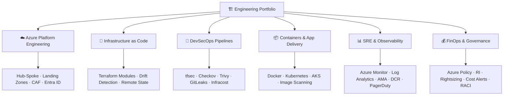

<div align="center">


<a href="https://readme-typing-svg.demolab.com/">
  
</a>

**Governed infrastructure. Automated security. Zero-downtime delivery.**

[](https://linkedin.com/in/rajeev-kumar783)
[](https://github.com/rajeev-kumar783?tab=repositories)
[](#)
[](https://github.com/rajeev-kumar783)


</div>

---

## 👋 About

I am a DevSecOps engineer and Cloud Architect focused on Microsoft Azure, enterprise landing zone design, Infrastructure as Code, and end-to-end migration governance. This GitHub profile documents production-grade implementations, architectural decision records, and real-world operational patterns from enterprise environments.

My professional focus: making cloud infrastructure **secure by design, auditable by default, and resilient under failure** — from Hub-and-Spoke network topology and Terraform pipelines to FinOps optimization and DR strategy.

- 🎯 **Specialization:** Azure Cloud Architecture, DevSecOps, Enterprise Migration (100+ workloads), Landing Zones
- 🏗️ **Core Tools:** Terraform, Azure DevOps, Defender for Cloud, Azure Monitor, Entra ID, PIM
- 🔐 **Security Mindset:** Shift-left security, CIS benchmarks, Policy-as-Code, Zero Trust networking
- 💰 **Business Impact:** 28% cloud spend reduction, zero-downtime migrations, automated governance

> **Portfolio principle:** infrastructure code should explain *why* decisions were made, *what risks* were evaluated, and *how* to validate correctness in production — not just pass a pipeline gate.

---

## 🧭 Portfolio Architecture



---

## 🧰 Technology Arsenal

<div align="center">

[](https://skillicons.dev)

</div>

| Domain | Tools & Practices |
|---|---|
| ☁️ **Cloud Platform** | Microsoft Azure, Subscriptions, Management Groups, Azure CAF, Landing Zones |
| 🏗️ **IaC & Automation** | Terraform, Bicep, ARM, AzureRM Provider, Reusable Modules, Semantic Versioning |
| 🔄 **CI/CD & GitOps** | Azure DevOps Pipelines, GitHub Actions, YAML Templates, Trunk-Based Dev, CODEOWNERS |
| 🔐 **DevSecOps** | tfsec, Checkov, Trivy, GitLeaks, Infracost, Defender for Cloud, PIM, Conditional Access |
| 🌐 **Networking** | Hub-and-Spoke VNet, ExpressRoute, S2S VPN, Azure Firewall Premium, Private DNS, IPAM |
| 🔑 **Identity & IAM** | Microsoft Entra ID, RBAC, PIM (JIT), Managed Identities, Service Principals |
| 📊 **Observability** | Azure Monitor, Log Analytics, AMA, DCR, Action Groups, Teams/Slack/PagerDuty |
| 💰 **FinOps** | Reserved Instances, Savings Plans, Rightsizing, Auto Start/Stop, Cost Anomaly Alerts |
| 🐧 **Systems** | Linux, Bash, PowerShell, Python, Git, Cloud-Init, VM Custom Data |

---

## 🏅 Certifications & Learning Path

| Status | Certification |
|:---:|:---|
| 🎯 In Progress | **AZ-104** — Microsoft Azure Administrator |
| 🎯 In Progress | **AZ-400** — Designing and Implementing Microsoft DevOps Solutions |
| 📅 Planned | **AZ-305** — Designing Microsoft Azure Infrastructure Solutions |
| 📅 Planned | **AZ-500** — Microsoft Azure Security Technologies |
| 📅 Planned | **HashiCorp Terraform Associate** |

---

## 🚀 Featured Projects

### 1. 🌐 Azure Production Landing Zone (Hub-and-Spoke)
Terraform implementation of a production-grade Azure Landing Zone using the Microsoft Cloud Adoption Framework. Covers Management Group hierarchy, Hub-and-Spoke VNet with Azure Firewall, Private DNS Zones, RBAC, and Azure Policy assignments. Includes full CI/CD pipeline with tfsec, Checkov, and Infracost gates.

- 📁 [Repository](#) · 🔄 [Pipeline Runs](#) · 📄 [Architecture Decision Record](#)

### 2. 🔐 DevSecOps Pipeline Automation Platform
End-to-end Terraform + Azure DevOps pipeline framework implementing shift-left security: tflint → GitLeaks → tfsec → Checkov → Trivy → Infracost → Manual Approval Gate → Apply. Includes automated drift detection via scheduled nightly `terraform plan` runs.

- 📁 [Repository](#) · 🔄 [Workflow Runs](#) · 🔒 [Security Policy](#)

### 3. 🏢 Enterprise Migration Runbook — 100+ Workloads
Documented operational playbook covering the full migration lifecycle: Discovery (Azure Migrate) → Assessment (TCO/ROI) → Landing Zone Readiness → Cutover (zero-downtime DNS flip) → Hypercare (24x7 war room). Includes RACI matrix, escalation paths, and post-migration benchmarks.

- 📁 [Repository](#) · 📋 [Operations Runbook](#) · 📊 [Migration Checklist](#)

### 4. 💰 FinOps Automation Toolkit
Azure automation scripts and dashboards for cloud cost governance: idle resource detection, VM rightsizing recommendations (P95 CPU/Memory), auto start/stop for non-prod environments, and Log Analytics DCR tuning to reduce ingestion costs.

- 📁 [Repository](#) · 📊 [Cost Dashboard](#)

### 5. 📊 Enterprise Observability Platform
Centralized observability setup using Azure Monitor, Log Analytics Workspace, Azure Monitor Agent (AMA), and Data Collection Rules (DCR). Includes Grafana dashboards, PagerDuty alerting, and SLO/error-budget tracking with incident runbooks.

- 📁 [Repository](#) · 📈 [Grafana Dashboards](#) · 📋 [Incident Runbook](#)

---

## 🏛️ Architecture Deep Dive

<details>
<summary><b>🌐 Hub-and-Spoke Network Design (Click to expand)</b></summary>

```
                  ┌──────────────────────────────────┐
                  │      On-Premises Datacenter 🏢    │
                  └─────────────────┬────────────────┘
                                    │
                  ┌─────────────────▼────────────────┐
                  │   ExpressRoute / S2S VPN Gateway  │
                  └─────────────────┬────────────────┘
                                    │
┌───────────────────────────────────▼──────────────────────────────────────┐
│                    🔷 HUB VNet — Central Connectivity                      │
│                                                                           │
│  ┌──────────────────┐  ┌─────────────────┐  ┌────────────────────┐       │
│  │  Azure Firewall  │  │ Gateway Subnet  │  │  Private DNS Zones │       │
│  │  Premium / NVA   │  │  (VPN/ER GW)    │  │  (Centralized Res) │       │
│  └────────┬─────────┘  └─────────────────┘  └────────────────────┘       │
└───────────│───────────────────────────────────────────────────────────────┘
            │  VNet Peering + UDR (0.0.0.0/0 → Firewall IP)
            ├─────────────────────┬──────────────────────┐
            │                     │                      │
┌───────────▼───────────┐ ┌───────▼───────────┐ ┌───────▼───────────┐
│  🟢 Spoke: App VNet   │ │ 🔵 Spoke: Shared  │ │ 🟡 Spoke: Data    │
│  ├ App Tier Subnets   │ │ ├ CI/CD Runners   │ │ ├ SQL Private EP  │
│  ├ DB Tier Subnets    │ │ ├ Bastion Host    │ │ ├ Storage PE       │
│  └ Private Endpoints  │ │ └ Security Tools  │ │ └ Key Vault PE     │
└───────────────────────┘ └───────────────────┘ └───────────────────┘
```

**Key Design Decisions:**
- All inter-spoke and egress traffic flows through Azure Firewall via UDRs — no spoke-to-spoke direct routing
- Private Endpoints for all PaaS services (SQL, Storage, Key Vault) with central Private DNS Zone resolution
- CIDR planning verified against on-prem ranges to eliminate all overlapping address spaces

</details>

<details>
<summary><b>🔐 Defense-in-Depth Security Model (Click to expand)</b></summary>

```
╔══════════════════════════════════════════════════════════════════════╗
║              🛡️  Multi-Layered Defense-in-Depth                      ║
╠══════════════════════════════════════════════════════════════════════╣
║  Layer 1 │ IDENTITY   │ Entra ID · PIM (JIT) · MFA · Cond. Access   ║
╠══════════════════════════════════════════════════════════════════════╣
║  Layer 2 │ NETWORK    │ Hub-Spoke · NSG/ASG · Firewall · DDoS Std   ║
╠══════════════════════════════════════════════════════════════════════╣
║  Layer 3 │ GOVERNANCE │ Azure Policy · CIS Benchmark · Defender Score║
╠══════════════════════════════════════════════════════════════════════╣
║  Layer 4 │ COMPUTE    │ Defender for Servers · CMK · Patch Baselines ║
╚══════════════════════════════════════════════════════════════════════╝
```

</details>

<details>
<summary><b>🏗️ Terraform DevSecOps Pipeline (Click to expand)</b></summary>

```
  ┌──────────────┐   ┌──────────────────────┐   ┌─────────────────────┐
  │  Git Push /  │──▶│  Lint & Format       │──▶│  Security Scanning  │
  │  Pull Request│   │  tflint · tf fmt     │   │  tfsec · Checkov    │
  └──────────────┘   └──────────────────────┘   │  Trivy · GitLeaks   │
                                                 └──────────┬──────────┘
                                                            │
  ┌──────────────┐   ┌──────────────────────┐   ┌──────────▼──────────┐
  │  Terraform   │◀──│  Manual Approval     │◀──│  Cost Estimation    │
  │  Apply 🚀    │   │  (Prod Gate ✅)       │   │  Infracost 💰        │
  └──────┬───────┘   └──────────────────────┘   └─────────────────────┘
         │
  ┌──────▼───────────────────────────────────────────────────────────────┐
  │  Remote State: Azure Blob Storage (Locked · Encrypted · Least Priv)  │
  │  Automated Drift Detection: nightly terraform plan -detailed-exitcode │
  └──────────────────────────────────────────────────────────────────────┘
```

</details>

<details>
<summary><b>☁️ Cloud Migration Lifecycle — 100+ Workloads (Click to expand)</b></summary>

```
 ┌────────────┐  ┌────────────┐  ┌────────────┐  ┌────────────┐  ┌────────────┐
 │🔍Discovery │─▶│📊Assessment│─▶│🏗️Readiness │─▶│✂️ Cutover  │─▶│🔥Hypercare │
 │            │  │            │  │            │  │            │  │            │
 │• Inventory │  │• Compat.   │  │• LZ Ready  │  │• DNS TTL ↓ │  │• 24x7 War  │
 │• Dep. Map  │  │• TCO / ROI │  │• Backup ✅  │  │• DB Sync   │  │  Room      │
 │• AZ Migrate│  │• Bandwidth │  │• Network   │  │• Traffic   │  │• Perf      │
 │  Reports   │  │  Sizing    │  │  Validated │  │  Rerouted  │  │  Bench     │
 └────────────┘  └────────────┘  └────────────┘  └────────────┘  └────────────┘
```

**Result:** 100+ enterprise workloads migrated · **Zero downtime** · **28% cloud cost reduction**

</details>

<details>
<summary><b>🏢 Entra ID & Management Group Hierarchy (Click to expand)</b></summary>

```
                     ┌──────────────────────────────┐
                     │   Microsoft Entra ID Tenant  │
                     └──────────────┬───────────────┘
                                    │
                     ┌──────────────▼───────────────┐
                     │      Tenant Root Group        │
                     └──────────────┬───────────────┘
          ┌───────────────────────────┼───────────────────────────┐
          │                           │                           │
┌─────────▼─────────┐  ┌─────────────▼───────┐  ┌───────────────▼───────┐
│ 🔷 Platform MG    │  │ 🟢 Landing Zones MG │  │ 🔴 Sandbox / Decom    │
│ ├ Identity        │  │ ├ Corp (Internal)   │  │ ├ Sandbox MG          │
│ ├ Management      │  │ ├ Online (DMZ)      │  │ └ Decommissioned MG   │
│ └ Connectivity    │  │ ├ Dev Subscriptions │  └───────────────────────┘
│   (Hub/Firewall)  │  │ ├ UAT Subscriptions │
└───────────────────┘  │ └ Prod Subscriptions│
                       └────────────────────┘
```

</details>

---

## 🔐 Engineering Principles

- **Infrastructure as Code:** All infrastructure is version-controlled, peer-reviewed, and reproducible — no manual console changes in production.
- **Shift security left:** Scan, lint, and cost-check before a single resource is planned, not after deployment.
- **Zero Trust networking:** No implicit trust between network segments; all traffic inspected through centralized firewall.
- **Least privilege by default:** Group-based RBAC with Entra ID; JIT access via PIM with multi-stage approval for privileged roles.
- **Protect credentials:** No secrets in code, no local state files, no hard-coded credentials — Managed Identities and Key Vault everywhere.
- **Governance before scale:** Azure Policy and CIS benchmark enforcement at Management Group level before workloads onboard.
- **Operational readiness:** No deployment is complete without dashboards, alert rules, runbooks, and validated rollback procedures.
- **Evidence over claims:** Document what has been tested, what was validated in production, and what limitations remain — not just what is planned.

---

## 🎯 Current Focus Areas

- 📐 Documenting reusable Terraform module library with semantic versioning and full CI/CD security gates
- 🔍 Building automated drift detection and compliance reporting dashboards
- 🔐 Improving PIM workflows and Conditional Access policy documentation
- 📊 Adding validated architecture diagrams and ADRs to all project READMEs
- 💰 Publishing FinOps automation scripts with measurable cost savings results

---

## 📈 GitHub Stats

<div align="center">


</div>

<div align="center">

[](https://git.io/streak-stats)

[](https://github.com/ashutosh00710/github-readme-activity-graph)

</div>

---

## 🤝 Connect

Open to collaboration and opportunities in Azure DevSecOps, Cloud Architecture, Terraform IaC, Enterprise Migration, SRE, and Platform Engineering.

<div align="center">

[](https://linkedin.com/in/rajeev-kumar783)
[](https://github.com/rajeev-kumar783?tab=repositories)
[](#)

> *"Infrastructure should be boring. Deployments should be boring.*
> *What should never be boring is the business value we unlock."*


</div>
